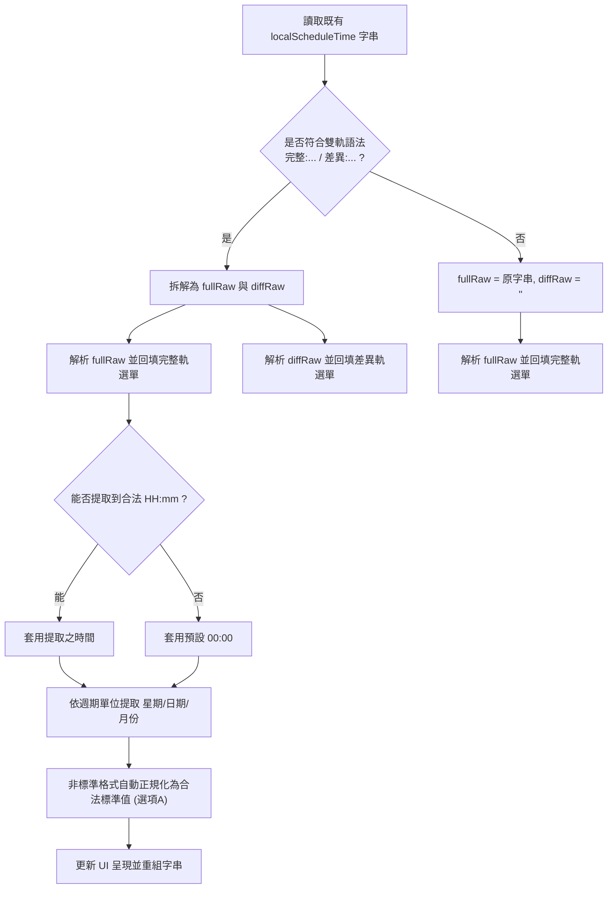

# 智慧排程時間連動選擇器與雙軌標準化語法設計規範 (Design Spec)

- **狀態**：Approved (Brainstormed with User)
- **日期**：2026-09-21
- **目標系統**：`biobank_manager/backup_control`
- **下游依賴系統**：`biobank_manager/data-termination-backup-termination`（自動銷毀追蹤系統）

---

## 1. 背景與問題陳述 (Problem & Background)

在現行「備份管制系統」中，「本地_排程時間」與「異地_排程時間」係透過純文字輸入框（`<input type="text">`）讓使用者自由輸入。

雖然系統提供了預設值 `每日 00:00`，但在實務維運中，使用者常會依個人習慣隨意填寫（例如：「半夜十二點」、「02:00」、「星期日清晨」、「每月1號」、「24:00」等）。
下游專案（特別是 `data-termination-backup-termination` 自動銷毀追蹤系統）需讀取備份管制表作為不可變政策主檔（SSOT）。由於缺乏嚴格格式約束，下游系統無法使用確定性正規表達式（Deterministic Regex Parser）解析出具體的執行時間與週期，導致自動排程推算、銷毀邊界日檢核與主管雙簽審查出現語法解析分歧與維運隱患。

因此，亟需在前端表單導入**智慧連動排程選擇器（Composite Schedule Selector）**，並制定統一的**跨專案排程時間格式標準契約**。

---

## 2. 設計目標 (Design Goals)

1. **結構化防呆輸入**：徹底廢除純文字手動輸入，改為根據週期單位動態切換的結構化選單（下拉選單 ＋ 原生時間選擇器），使使用者**無法輸入任何非法字元或非標準格式**。
2. **雙軌個別標註語法**：本地備份若同時啟用「完整備份」與「差異備份」，自動合成標準雙軌格式；若僅設定單一備份軌，則保持乾淨的單軌格式。
3. **對稱支援異地備份**：異地備份對稱採用相同標準的時間格式生成邏輯。
4. **歷史非標準資料自動正規化**：編輯既有紀錄時，若遇到歷史非標準格式，自動依照當前週期單位與提取到的時間資訊，正規化為標準預設值，達到「編輯一次即洗淨歷史資料」的效果。
5. **後端透明無縫相容**：後端資料表結構、儲存欄位名與 API 介面維持不變，前端在送出時自動封裝為標準字串寫入主表第 11 欄（本地）與第 18 欄（異地）。

---

## 3. 標準排程時間格式契約 (Standard String Contract)

### 3.1 單軌基礎語法 (Single Track Syntax)

| 週期單位 | 前端輸入控制項組合 | 標準輸出字串格式 | 實際範例 |
|---|---|---|---|
| **天** | 靜態標籤 `每日` ＋ 時間選單（`<input type="time">`） | `每日 HH:mm` | `每日 00:00`<br>`每日 02:30` |
| **週** | 星期下拉選單（`每週一`～`每週日`）＋ 時間選單 | `每週{一~日} HH:mm` | `每週日 02:00`<br>`每週三 01:00` |
| **個月** | 靜態標籤 `每月` ＋ 日期下拉選單（`1 日`～`31 日`、`月底最後一日`）＋ 時間選單 | `每月 {1~31} 日 HH:mm`<br>或 `每月月底最後一日 HH:mm` | `每月 1 日 03:00`<br>`每月月底最後一日 23:00` |
| **年** | 靜態標籤 `每年` ＋ 月份選單（`1 月`～`12 月`）＋ 日期選單 ＋ 時間選單 | `每年 {1~12} 月 {1~31} 日 HH:mm`<br>或 `每年 {1~12} 月月底最後一日 HH:mm` | `每年 12 月 31 日 23:00`<br>`每年 6 月 30 日 02:00` |
| **版本** | 靜態提示標籤（隱藏時間輸入框） | `每次版本發布` | `每次版本發布` |

> [!NOTE]
> - **系統日誌檔（log）**：依業務實務，日誌檔在表單中不設備份週期單位，固定遵循天週期模式，提供時間輸入項，預設輸出 `每日 00:00`。
> - **時間格式規範**：一律為 24 小時制 `HH:mm`（補齊兩位數，例如 `02:00`，不得寫成 `2:00`）。

### 3.2 雙軌合成語法 (Dual-track Synthesis Syntax)

本地備份同時存在「完整備份」與「差異備份」兩軌：

1. **雙軌皆有設定（完整備份有效 且 差異備份數值 > 0 且單位有效）**：
   - 格式：`完整:{完整排程字串} / 差異:{差異排程字串}`
   - 範例：`完整:每週日 02:00 / 差異:每日 02:00`
   - 範例：`完整:每月 1 日 03:00 / 差異:每週日 01:00`
2. **僅有完整備份（差異備份值為 0 或留空）**：
   - 格式：`{完整排程字串}`
   - 範例：`每週日 02:00`、`每日 00:00`
3. **僅有差異備份（特殊邊界）**：
   - 格式：`{差異排程字串}`
   - 範例：`每日 02:00`
4. **異地備份**：
   - 永遠為單軌：勾選異地備份為「否」時為 `無`；為「是」時輸出單軌標準格式（如 `每週日 04:00`）。

---

## 4. 前端元件架構與互動流程 (Frontend Component Architecture)

### 4.1 DOM 結構設計

在每個標的卡片（`target.id`）內部，原有的單一文字輸入框將重構成結構化控制元件群，並保留一個隱藏的 `<input type="hidden">` 作為最終合成值的儲存載體：

```html
<!-- 本地排程區塊容器 -->
<div class="local-schedule-composite space-y-2">
  <!-- 完整備份排程選擇器 -->
  <div id="fullSchedulePicker_${target.id}" class="schedule-picker-track flex flex-wrap items-center gap-2">
    <span class="text-xs font-semibold text-gray-500 w-16">完整排程:</span>
    <span class="prefix-label text-sm text-gray-700"></span>
    <select id="fullSchedMonth_${target.id}" class="hidden sched-month rounded-md border-gray-300 p-1.5 text-sm">...</select>
    <select id="fullSchedDay_${target.id}" class="hidden sched-day rounded-md border-gray-300 p-1.5 text-sm">...</select>
    <select id="fullSchedWeekday_${target.id}" class="hidden sched-weekday rounded-md border-gray-300 p-1.5 text-sm">...</select>
    <input type="time" id="fullSchedTime_${target.id}" class="sched-time rounded-md border-gray-300 p-1.5 text-sm" value="00:00">
    <span id="fullSchedVersionTag_${target.id}" class="hidden text-xs bg-blue-100 text-blue-800 px-2 py-1 rounded">每次版本發布</span>
  </div>

  <!-- 差異備份排程選擇器（僅在差異備份 > 0 時可見） -->
  <div id="diffSchedulePicker_${target.id}" class="schedule-picker-track flex flex-wrap items-center gap-2">
    <span class="text-xs font-semibold text-gray-500 w-16">差異排程:</span>
    <span class="prefix-label text-sm text-gray-700"></span>
    <select id="diffSchedMonth_${target.id}" class="hidden sched-month rounded-md border-gray-300 p-1.5 text-sm">...</select>
    <select id="diffSchedDay_${target.id}" class="hidden sched-day rounded-md border-gray-300 p-1.5 text-sm">...</select>
    <select id="diffSchedWeekday_${target.id}" class="hidden sched-weekday rounded-md border-gray-300 p-1.5 text-sm">...</select>
    <input type="time" id="diffSchedTime_${target.id}" class="sched-time rounded-md border-gray-300 p-1.5 text-sm" value="00:00">
    <span id="diffSchedVersionTag_${target.id}" class="hidden text-xs bg-blue-100 text-blue-800 px-2 py-1 rounded">每次版本發布</span>
  </div>

  <!-- 最終合成之排程時間字串（供表單送出） -->
  <input type="hidden" id="localScheduleTime_${target.id}" value="每日 00:00">
  <!-- 即時語法預覽 -->
  <div class="text-xs text-blue-600 font-mono mt-1" id="localSchedulePreview_${target.id}">排程設定值: 每日 00:00</div>
</div>
```

異地存放區塊（`offsiteSection_${target.id}`）內部亦配置對稱的 `offsiteSchedulePicker_${target.id}` 與隱藏的 `offsiteScheduleTime_${target.id}`。

### 4.2 控制器邏輯 (Controller Logic)

1. **週期單位連動監聽器 (`onUnitChange`)**：
   - 當使用者變更 `fullUnit_${target.id}` 或 `diffUnit_${target.id}` 或 `offsiteFreqUnit_${target.id}` 時：
   - 呼叫 `renderSchedulePickerTrack(targetId, track, unit)`：
     - `天`：顯示 `[每日]` 標籤 ＋ 時間選單；隱藏星期/月份/日期選單及版本標籤。
     - `週`：顯示星期下拉選單（預設每週日）＋ 時間選單；隱藏月份/日期選單及版本標籤。
     - `個月`：顯示 `[每月]` 標籤 ＋ 日期選單（預設 1 日）＋ 時間選單；隱藏星期/月份選單。
     - `年`：顯示 `[每年]` 標籤 ＋ 月份選單（預設 12 月）＋ 日期選單（預設 31 日）＋ 時間選單。
     - `版本`：顯示版本標籤 `每次版本發布`；隱藏時間選單及所有日期選單。
2. **差異軌可見度切換 (`onDiffValueChange`)**：
   - 當 `diffValue_${target.id}` 變更：
     - 若為 `0`、空值或小於等於 0：隱藏 `diffSchedulePicker_${target.id}`，合成字串僅保留完整排程。
     - 若大於 `0`：顯示 `diffSchedulePicker_${target.id}`，合成字串進入雙軌模式。
3. **即時合成同步器 (`syncScheduleString`)**：
   - 任何下拉或時間改變時，即時重組字串，更新隱藏 input 與 UI 預覽文字。

---

## 5. 歷史資料反向解析與正規化演算法 (Reverse Parsing & Hydration Algorithm)

在 `editSystem(id)` 載入既有系統資料時，需將資料庫中的字串解構並回填至對應下拉選單中：



### 反向解析正規表達式矩陣：
- **時間提取**：`/(?:^|[^\d])([01]?\d|2[0-3]):([0-5]\d)(?::\d{2})?(?:[^\d]|$)/`
- **星期提取**：`/每?週([一二三四五六日])/`
- **日期提取**：`/每?月(?:底最後一日|([0-3]?\d)\s*日?)/`
- **月份提取**：`/每?年\s*([0-1]?\d)\s*月/`
- **版本識別**：`/(?:版本|發布|release|version)/i`

若解析失敗或缺少部分屬性，一律自動落入安全預設值（週設為日、月設為 1 日、時間設為 00:00），並在編輯儲存時無痕替換為乾淨標準字串。

---

## 6. 下游專案相容性與資料契約 (Cross-Project Compatibility)

### 6.1 下游系統 `data-termination-backup-termination`
下游系統的 `RuntimeAdapters.createBackupControlReader` 讀取邏輯如下：
```javascript
localScheduleTime: localTimeCol !== -1 && row[localTimeCol] ? String(row[localTimeCol]).trim() : '未指定',
offsiteScheduleTime: offsiteTimeCol !== -1 && row[offsiteTimeCol] ? String(row[offsiteTimeCol]).trim() : '未指定',
```
該系統將此欄位作為立案政策快照儲存於案件中，並在立案步驟三卡片中直接渲染呈現。

- **相容性保證**：本設計輸出的繁體中文字串（如 `每週日 02:00`、`完整:每週日 02:00 / 差異:每日 02:00`）在下游 UI 呈現極為清晰專業。
- **未來擴展性**：下游系統未來若需進一步根據排程時間計算下次備份時間戳記或銷毀邊界日，可使用本規範第 3 節明確定義的標準正則表達式 100% 精確解析。

---

## 7. 驗證計畫 (Verification Plan)

### 7.1 自動化單元測試
使用 Node.js 執行單元測試，驗證以下核心純函式邏輯：
1. **週期狀態機切換驗證**：天、週、月、年、版本各單位之可見元件與預設值正確性。
2. **雙軌合成語法驗證**：
   - 完整（週）＋ 差異（天）-> `完整:每週日 02:00 / 差異:每日 00:00`
   - 僅完整（月）-> `每月 1 日 03:00`
   - 僅完整（天）-> `每日 00:00`
   - 僅完整（版本）-> `每次版本發布`
   - 月底選項 -> `每月月底最後一日 23:00`
3. **反向解析與正規化驗證**：
   - 各種標準語法反向解析還原。
   - 非標準歷史舊值（如「02:00」、「半夜十二點」）自動正規化。

### 7.2 手動驗收步驟
1. 展開表單標的卡片，切換完整週期單位（天 -> 週 -> 月 -> 年 -> 版本），確認輸入元件即時對應切換。
2. 設定完整備份為每週日 02:00，差異備份填寫 1 天 00:00，確認預覽與隱藏欄位值為 `完整:每週日 02:00 / 差異:每日 00:00`。
3. 將差異備份改為 0（無差異），確認排程自動降級為單軌 `每週日 02:00`。
4. 測試「月份」週期，選取「月底最後一日」，確認輸出 `每月月底最後一日 00:00`。
5. 測試送出表單，確認試算表主表第 11 欄完整記錄標準格式。
6. 編輯該系統，確認各下拉選單正確回填剛才設定之數值。
