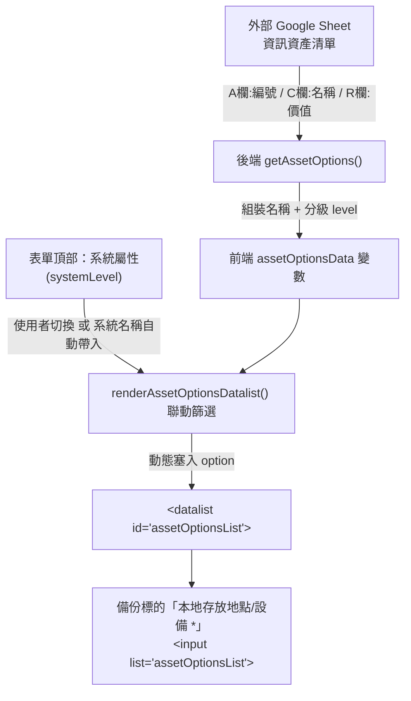

# 「本地存放地點/設備」下拉選單載入邏輯與資料架構分析

本文件針對備份管制系統（`backup_control`）中，各備份標的之「**本地存放地點/設備 \***」下拉選單進行深入的資料流與程式邏輯分析，並梳理潛在的業務限制與後續可評估之優化方案。

---

## 1. 資料來源與試算表定位

「本地存放地點/設備」欄位的下拉選單資料並非寫死在程式內，而是動態讀取外部的 **資訊資產管理試算表**：

| 項目 | 設定與讀取位置 | 說明 |
| :--- | :--- | :--- |
| **試算表來源** | `env.js` 中的 `ASSETS_SPREADSHEET_ID` | 指定外部「資訊資產」Google Sheet 檔案 ID |
| **目標工作表** | `SHEET_ASSETS_NAME` (`資訊資產清單`) | 若找不到該分頁，則後端自動降級尋找名為 `資訊資產` 的分頁 |
| **讀取範圍** | 第 2 列起（排除表頭），A 欄至 R 欄 (第 1~18 欄) | 透過 `assetsSheet.getRange(2, 1, lastRow - 1, 18).getValues()` 一次取出 |
| **權限驗證** | `checkAppPermission_()` | 讀取該外部試算表的 `權限` 工作表 B 欄，確認登入者 Email 在白名單內 |

---

## 2. 後端資料載入與轉換邏輯 (`code.js` -> `getAssetOptions()`)

當前端發動 `google.script.run.getAssetOptions()` 時，後端執行以下資料轉換：

### (1) 欄位提取與名稱組裝 (`name`)
- **Col A (第 1 欄)**：資產編號
- **Col C (第 3 欄)**：資產名稱
- **組裝規則**：
  ```javascript
  const colA = String(row[0] || '').trim();
  const colC = String(row[2] || '').trim();
  const name = colC ? (colA ? (colA + ' - ' + colC) : colC) : colA;
  ```
  - 若 A、C 欄皆有值：呈現為 `"{資產編號} - {資產名稱}"`（例如：`FA-2024-001 - 核心資料庫備份伺服器`）。
  - 若僅有 C 欄：呈現為 `"{資產名稱}"`。
  - 若僅有 A 欄：呈現為 `"{資產編號}"`。
  - 若兩者皆為空：略過不納入。

### (2) 屬性等級判定 (`level`)
後端依據 **Col R (第 18 欄：資產價值)** 的數值進行安全防護分級：
```javascript
let level = '一般系統';
const rValue = parseFloat(colR);
if (!isNaN(rValue) && rValue >= 7) {
  level = '關鍵核心系統';
}
```
- **資產價值 $\ge 7$**：標記為 `'關鍵核心系統'`。
- **資產價值 $< 7$ 或非數值**：標記為 `'一般系統'`。

### (3) 去重與排序
- 透過 `seen` Hash 物件過濾重複的 `name`。
- 依名稱中文自然排序：`result.assets.sort((a, b) => a.name.localeCompare(b.name))`。
- 回傳格式為：
  ```json
  {
    "name": "FA-2024-001 - 核心資料庫備份伺服器",
    "level": "關鍵核心系統",
    "rawR": 8
  }
  ```

---

## 3. 前端呈現與動態連動過濾機制 (`Index.html`)

在前端介面中，「本地存放地點/設備」是以 HTML5 `<input type="search">` 搭配 `<datalist id="assetOptionsList">` 實作：



### (1) 系統屬性（防護等級）連動篩選
`renderAssetOptionsDatalist()` 會讀取表單頂部的「系統屬性（`<select id="systemLevel">`）」：
- **若尚未選擇系統屬性（空值）**：下拉選單會載入外部清冊中的**全部資訊資產**。
- **若系統屬性已選取為「關鍵核心系統」**：下拉選單**只會顯示**資產價值 $\ge 7$ 的資訊資產。
- **若系統屬性已選取為「一般系統」**：下拉選單**只會顯示**資產價值 $< 7$ 的資訊資產。
- **自動帶入效應**：當使用者在第一區輸入「系統名稱」時，系統若匹配到該系統的等級，會自動更新 `systemLevel` 並連帶刷新 `assetOptionsList`。

### (2) 嚴格驗證機制（防呆阻擋）
在表單送出（`handleFormSubmit`）時，系統會調用 `validateLocalLocationSelection(activeTargets)`：
- 使用者在所有啟用的備份標的中所填寫的「本地存放地點/設備」，**必須 100% 精準匹配 `assetOptionsData` 內的合法 `name` 字串**。
- 若使用者自行輸入非清冊中的文字（例如自填「機房機櫃3」、「本機硬碟」），表單會被阻擋並彈出警告：
  > `「{標的名稱}」的本地存放地點/設備請從下拉選單選擇有效的資訊資產。`

---

## 4. 現行機制的潛在業務盲點與疑慮

根據上述邏輯，在實際業務操作中存在以下幾個常見現象：

> [!WARNING]
> ### 1. 「系統屬性」將高低價值設備完全隔離
> 若被備份的系統為「關鍵核心系統」，但其所存放的本地備份設備（例如某台特定 NAS、備份硬碟機）在資訊資產表的「資產價值」被評估為 6 分或未填寫，使用者在下拉選單中將**完全找不到**該備份設備！
> 同理，若系統為「一般系統」，但備份放置於高等級的集中儲存設備（價值 $\ge 7$），也會因為過濾條件而被隱藏。

> [!NOTE]
> ### 2. 缺乏「資產類型/類別」過濾
> 目前後端讀取資訊資產清單時，**未限制資產類別**。如果資訊資產表中包含了「應用軟體」、「文檔資料」或「終端 PC」，只要有編號或名稱，皆會被載入至備份存放設備選單中。

> [!IMPORTANT]
> ### 3. 欄位固定依賴第 18 欄 (Col R)
> 目前程式中資產價值是寫死取用第 18 欄（0-indexed 的 17）。若外部資訊資產試算表欄位有增刪、調整順序，會直接導致等級判定失準。

---

## 5. 後續優化規劃方向（待使用者確認）

若您後續有調整此下拉選單的需求，可評估以下方案：

1. **方案 A（解除存放設備的等級硬性隔離）**：
   - 「本地存放地點/設備」下拉選單不依據 `systemLevel` 進行強制過濾，維持顯示所有可用的硬體/伺服器設備；或者僅在第一區「系統名稱」做等級過濾，存放設備允許跨等級選擇。
2. **方案 B（增加資產類別過濾）**：
   - 僅載入資產類別屬於「伺服器」、「儲存設備」、「網路設備」、「硬體」等備份存放相關的資產，排除無關資產。
3. **方案 C（動態表頭比對，提升強韌度）**：
   - 將資產清單的讀取改為 Header-Aware（透過「資產編號」、「資產名稱」、「資產價值」等表頭動態尋找欄位索引），避免外部試算表欄位順序更動時失效。
